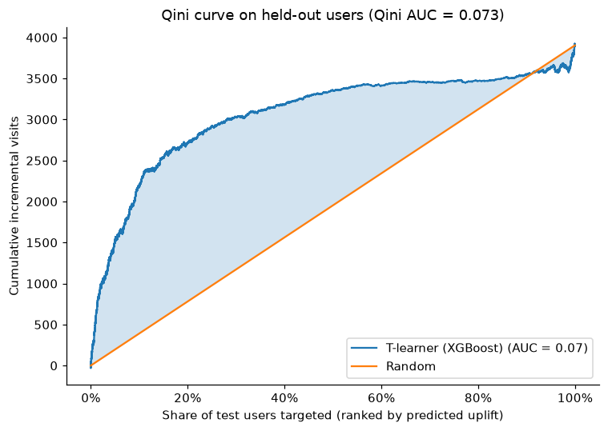

# Measuring Ad Incrementality: Criteo Uplift Experiment

**Do ads cause more visits, by how much, and for whom?** I analyzed a randomized ad experiment with 1,397,959 users
(a 10% sample of the Criteo Uplift dataset) end to end: validity checks, lift estimation, variance reduction,
non-compliance, uplift modeling, and segment analysis. After correcting for a pre-treatment imbalance I found in the
pooled data, ads raised the visit rate by **20.2%** (+0.81 percentage points). The effect is highly concentrated:
targeting the top 30% of users by predicted uplift captures about **80%** of incremental visits.

| Result | Estimate | 95% CI |
|---|---|---|
| **Visit lift, regression-adjusted (headline)** | **+0.812 pp (+20.2%)** | [0.730, 0.893] pp |
| Visit lift, unadjusted (simple comparison) | +1.067 pp (+27.9%) | [0.976, 1.157] pp |
| Visit lift, doubly robust AIPW (robustness check) | +0.777 pp (+19.2%) | [0.692, 0.862] pp |
| Effect on users who actually saw ads (adjusted CACE) | +22.93 pp (18.76% → 41.68%, +122%) | [20.64, 25.21] pp |
| Share of incremental visits from top 10% / 20% / 30% of users | 55.4% / 72.3% / 80.2% | 5-seed ranges: 50.7–57.7% / 68.6–76.2% / 77.6–85.0% |

<sub>pp = percentage points. Regression adjustment uses Lin (2013) with treatment × covariate interactions and HC1
standard errors. Each relative lift divides by the no-ad visit rate for the same population as its effect: 4.022%
for the adjusted lift (the control model applied to all users), 3.818% (raw control rate) for the unadjusted one.
Targeting shares are standard Qini shares on held-out users, averaged over 5 seeds (42–46).</sub>



<sub>Qini curve on held-out users for one split (seed 42). Steeper early rise = the model finds persuadable users first.
The diagonal is random targeting.</sub>

---

## Decision memo

### TL;DR
Ads work: they cause a real, precisely measured increase in visits and conversions. But most of the effect comes from
a minority of users. **Recommendation: keep ads on, and prioritize impressions by uplift-model score** rather than
showing them uniformly. Targeting the top 20–30% of users captures roughly 72–80% of incremental visits. The exact
cutoff should come from ad-cost data, which this dataset doesn't include.

### 1. Results
- **Visits:** ads raised the visit rate by **0.812 pp, or +20.2%** (95% CI [0.730, 0.893] pp), after regression adjustment.
  The unadjusted comparison is 3.818% → 4.885% (+27.9%), which overstates the effect (see section 2).
- **Which baseline:** the 20.2% divides by 4.022%, the predicted no-ad visit rate for the full sample. The adjusted effect
  averages over all users, so its baseline must too. Dividing by the raw control rate (3.818%) would give 21.3%, but it
  mixes populations: control users are slightly lighter visitors than the full sample, the same imbalance as in section 2.
- **Conversions** (secondary metric): +0.104 pp, or +49.0% (95% CI [0.082, 0.125] pp), adjusted. Conversions are
  19.4x rarer than visits in the control group, which is why visit is the primary metric. The minimum detectable effect is a 3.4% relative
  lift for visits but 15.5% for conversions.
- **Validity:** the 85/15 split matches the design (sample ratio mismatch test p = 0.262). No control user was exposed
  to an ad. Bootstrap CIs matched the formula CIs.

### 2. Imbalance discovery and correction
Every feature passed the usual balance threshold (all |standardized mean difference| < 0.1), but regression adjustment
moved the estimate by 0.255 pp, more than five times its standard error (0.0463 pp). Under clean randomization it should mainly narrow the CI. Digging in:
- **Several features are statistically imbalanced** (e.g. f3 at z = −20.7). With 1.4M users, "below 0.1" isn't the same
  as "balanced."
- **Combined, the imbalance is worth +0.24 pp** (z = 10.4): predicting visits from features alone, treatment users
  look like heavier visitors before any ads. The unadjusted lift minus this gap (0.827 pp) matches the adjusted estimate.
- **Likely cause:** Criteo states the dataset is assembled from several incrementality tests. Pooling tests with
  different populations or treatment ratios can correlate treatment with features. This is a hypothesis; the test ID
  isn't in the data.
- **Correction:** Lin's regression adjustment removes the observable imbalance and **narrows the CI by 10.5%**.
  The result is robust across methods: IPW with a logistic propensity model gives 0.821 pp, and cross-fitted doubly
  robust AIPW gives 0.777 pp. The propensity AUC is 0.5097, so assignment is almost, but not entirely, unpredictable.
  Plain IPW with an XGBoost propensity model (0.628 pp) is unstable because of extreme weights (max weight 207).

### 3. Effect on users who actually saw ads
Only 3.54% of treatment users were exposed (adjusted). Using assignment as an instrument for exposure, the
**effect on exposed users is +22.93 pp** (95% CI [20.64, 25.21]). They would visit 18.76% of the time without ads and
41.68% with them (+122%). A naive exposed-vs-unexposed comparison (+38.33 pp) overstates this by about two thirds,
because exposed users are heavy browsers. The unadjusted IV estimate (+29.62 pp) is inflated by the section 2 imbalance,
which gets divided by the small exposed share.

### 4. Targeting
An XGBoost T-learner (separate models for treated and control users) predicts each user's uplift. On held-out users
its Qini AUC is 0.0735 on average (range 0.0702–0.0762) vs. about zero for random scores. Averaged over 5 seeds,
targeting the top **10% / 20% / 30%** captures **55.4% / 72.3% / 80.2%** of incremental visits, vs. 10% / 20% / 30% for random.
*Sensitivity check:* recomputing each group's increment with the adjusted estimator gives 66.0% / 79.1% / 82.5%.

### 5. Segments
The effect varies sharply by segment: +2.65 pp in the lowest f6 bucket and +1.50 pp in the lowest f0 bucket, vs.
+0.06 pp (not significant) in the highest f0 bucket. Results hold after Holm and Benjamini–Hochberg correction.
- f0 and f6 were **chosen for their spread, before looking at effects**, to avoid cherry-picking segments.
- The features are **anonymized**, so segments can't be turned into business rules ("target mobile users").
  **Targeting should use the uplift model's scores**, not hand-built segments.

---

## Caveats
- **Pooled tests:** the data combines several Criteo tests, and the test ID isn't available. Adjustment removes the
  imbalance we can observe from the 12 features, not any imbalance they don't capture.
- **10% sample:** a seeded random sample of the official file; the full ~14M rows would give tighter CIs.
- **IV assumptions:** the effect on exposed users assumes assignment affects visits only through ad exposure
  (exclusion restriction), and relies on one-sided non-compliance (verified) and random assignment (adjusted for).
- **Single dataset:** one advertiser context and one period; effects may not transfer.
- **Qini sensitivity:** the standard Qini count compares raw treated vs. control users, so it is affected by the
  section 2 imbalance; the adjusted shares above bound that sensitivity. Shares also vary by a few points across seeds.
- **No cost data:** the analysis measures visits, not return on ad spend.

---

## How to run
Requires Python 3.12. On macOS, XGBoost needs the OpenMP runtime: `brew install libomp`.

```bash
python3.12 -m venv .venv
.venv/bin/pip install -r requirements.txt
.venv/bin/jupyter nbconvert --to notebook --execute --inplace notebooks/analysis.ipynb
```

**Data:** `src/data.py` downloads the official Criteo Uplift v2.1 file (~311 MB, ~14M rows) from
[Criteo's Hugging Face page](https://huggingface.co/datasets/criteo/criteo-uplift) into `data/raw/` (git-ignored) on
first run. It then draws a 10% simple random sample with `random_state=42` and caches it as parquet in `data/processed/`.
(scikit-uplift's pre-made 10% download link is offline.) All seeds are fixed, so the notebook reproduces the numbers above.

`scikit-learn` is pinned to 1.4.2 because `scikit-uplift` 0.5.1 is incompatible with newer versions.

### Repository layout
```
notebooks/analysis.ipynb   narrative analysis, runs top to bottom
src/data.py                download + seeded 10% sample
src/validity.py            SRM, covariate balance, exposure, prognostic balance
src/effects.py             lift, CIs, bootstrap, power/MDE
src/variance.py            regression adjustment (ANCOVA, Lin), IPW, AIPW
src/compliance.py          ITT vs. CACE, complier decomposition
src/uplift.py              T-learner, Qini targeting, seed stability
src/segments.py            segment effects, Holm / BH correction
figures/                   plots used here and in the notebook
```

**Data citation:** Diemert, Betlei, Renaudin, Amini. *A Large Scale Benchmark for Uplift Modeling.* AdKDD 2018 Workshop.
